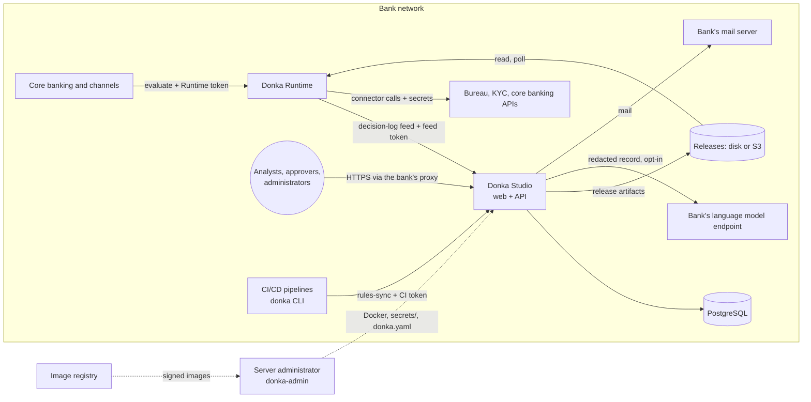

# Threat model

What can go wrong in a Donka installation, what stops it, and what is still open. Written with
STRIDE (spoofing, tampering, repudiation, information disclosure, denial of service, elevation
of privilege) over the whole installation, as DNK-69 asks. Each mitigation links to the code,
the configuration or the story that provides it. Review this page when a story adds a component,
an endpoint that crosses a trust boundary, or a new secret.

Last reviewed: 4 November 2026, on `develop` after DNK-49.

## The installation and its trust boundaries

| Boundary | Who is on the other side | What crosses it |
| --- | --- | --- |
| Browser ↔ Studio | Bank staff, and anyone who reaches the URL | Session cookie, rules, decision records, people's data |
| Customer systems ↔ Runtime | The bank's applications | Applicants' data in, decisions out |
| Runtime ↔ Studio | A Runtime in another network zone | Decision records (personal data) |
| Runtime ↔ external services | Bureaus, KYC, core banking | Applicants' data, connector secrets |
| Studio ↔ language model | The bank's chosen endpoint | Redacted decision records |
| Studio and Runtime ↔ storage | The bank's disk, S3 or SILO | Release artifacts that decide outcomes |
| Server ↔ registry | Donka's image registry | The software itself |
| Rule authors ↔ engine | Project editors | Graphs, expressions and JavaScript function nodes that run on the servers |

**Assets**, from most to least sensitive:
- Applicants' personal data and decisions (decision log, people's rights requests).
- The keys: `DONKA_DECISION_LOG_KEY`, `DONKA_PERSON_INDEX_KEY`, `DONKA_SECOND_STEP_KEY`, connector secrets, storage credentials.
- The integrity of released rules.
- Accounts and sessions.
- The audit trail.
- Availability of decisions.

**Actors:**
- An outsider on the network.
- A signed-in member in each role:
  - viewer, editor and owner per project;
  - administrator per installation.
- A compromised customer system holding a Runtime token.
- A compromised Runtime.
- Someone with access to the server or the bucket.
- A malicious or compromised upstream dependency.

## Threats and mitigations

Status:
- **Mitigated:** the control exists and is tested.
- **Open:** a story will close it before the pilot.
- **Accepted:** a stated reason and owner; the risk is not fixed.

### Studio: identity and sessions

| ID | STRIDE | Threat | Mitigation | Status |
| --- | --- | --- | --- | --- |
| ID-1 | S | Password guessing | Argon2 hashes with a length cap before hashing ([`crates/identity/src/secret.rs`](../../crates/identity/src/secret.rs)); lockout after repeated failures; per-address limits on sign-in and reset (`DONKA_SIGN_IN_RATE_LIMIT`, `DONKA_PASSWORD_RESET_RATE_LIMIT`, DNK-32); `X-Forwarded-For` trusted only from `DONKA_TRUSTED_PROXIES` | Mitigated |
| ID-2 | S | Stolen password | Second step with an authenticator app and recovery codes (DNK-59); required for roles chosen by `DONKA_MFA_REQUIRED`; the first administrator must enrol one (DNK-74). Secrets sealed with `DONKA_SECOND_STEP_KEY` | Mitigated; the bank chooses `DONKA_MFA_REQUIRED` (accepted, owner: customer) |
| ID-3 | S, I | Session theft | Cookie `HttpOnly`, `SameSite=Lax`, `Secure` behind HTTPS ([`apps/app/src/auth.rs`](../../apps/app/src/auth.rs)); idle expiry `DONKA_SESSION_IDLE_MINUTES`; sessions in Studio's own pool (ADR-007) | Mitigated |
| ID-4 | T | Cross-site request forgery | State-changing API requests need the `x-donka-csrf` header (`require_csrf_header` in [`apps/app/src/auth.rs`](../../apps/app/src/auth.rs)); same-origin web app (ADR-002) | Mitigated |
| ID-5 | I | Tokens in links leak through Referer or logs | `Referrer-Policy: same-origin`; spans record the route template, never the path or query ([`apps/app/src/lib.rs`](../../apps/app/src/lib.rs), [`telemetry.rs`](../../apps/app/src/telemetry.rs)); invitation and reset tokens are single-use and hashed | Mitigated |
| ID-6 | S | Taking over an empty installation | The first administrator comes only from the one-time link printed in the server's logs (DNK-74) | Mitigated |
| ID-7 | T, I | Script injection in the web app | React escaping; `X-Content-Type-Options: nosniff`; `X-Frame-Options: DENY`. No Content-Security-Policy, and no HSTS when served over HTTPS | **Open: DNK-85** |

### Studio: authorisation and change control

| ID | STRIDE | Threat | Mitigation | Status |
| --- | --- | --- | --- | --- |
| AZ-1 | E | A member reaches another project | Every project route takes `Access`, which proves membership and role (DNK-7, [`crates/project`](../../crates/project)); cross-project cases in the live tests (DNK-51) | Mitigated |
| AZ-2 | E, T | One person changes production rules alone | Production needs approval from someone other than the author (DNK-15); releases are immutable; rollback redeploys an older release (DNK-16) | Mitigated |
| AZ-3 | R | Denying a change, an approval or a record's opening | Append-only audit log written in the change's transaction; a trigger refuses updates and deletes ([`migrations/20260929000001_audit_events.sql`](../../migrations/20260929000001_audit_events.sql)) | Mitigated, see AC-1 |
| AZ-4 | E | A CI token used beyond its project | CI tokens are read-only, one project, hashed and revocable; another project answers `no_access` (DNK-20) | Mitigated |
| AZ-5 | E | A disabled module still reachable | Modules outside the licence or `DONKA_MODULES` answer `MODULE_OFF` (DNK-74, DNK-77) | Mitigated |

### Rule authoring: what an editor's rules can do on the servers

| ID | STRIDE | Threat | Mitigation | Status |
| --- | --- | --- | --- | --- |
| RA-1 | I, E | **A JavaScript function node calls any address.** zen-engine 2.x gives function nodes an `http` module with a native client, and Donka does not turn it off. An editor can make Studio's simulator, or a released rule on the Runtime, fetch internal services (cloud credential endpoints, admin consoles) and return the response in the result. Reproduced on 4 November 2026 against a local server. The engine's `http_auth` default can also attach cloud credentials | Mitigated (DNK-83): Studio and the Runtime turn off the engine's HTTP client and its credentials (`ZEN_CONFIG.http_native`, `http_auth` in [`crates/engine/src/lib.rs`](../../crates/engine/src/lib.rs)); tests in both repositories prove a local service receives nothing |
| RA-2 | D | A rule that loops or allocates without end | The engine stops a function node after 5 s; the Runtime limits requests per token (`RATE_LIMIT__REQUESTS`, DNK-22); Studio runs simulations on a bounded worker pool | Accepted: editors are named staff and every change is versioned and audited (owner: Donka) |
| RA-3 | T | A rule reads fields the contract does not declare, or a bad input reaches rules | Input contracts are enforced by every Runtime (`400` naming the field) and checked when a version is saved (DNK-37) | Mitigated |

### Connectors and secrets

| ID | STRIDE | Threat | Mitigation | Status |
| --- | --- | --- | --- | --- |
| CN-1 | I | **An editor sends a connector secret to an outside server.** A connector node names a secret and a URL. Nothing limits which URL a secret may be sent to, and staging releases need no approval, so an editor can point a node at their own server with the bureau's secret | **Open: DNK-84** |
| CN-2 | I | A connector follows a redirect and sends its headers (e.g. `X-Api-Key`) to another host | The client follows redirects by default | **Open: DNK-84** |
| CN-3 | I | Secrets in graphs, logs or Studio | Graphs store only a secret's name; values live in the Runtime's environment or `_FILE` files (DNK-65); Studio simulates connectors from mocks and never calls them ([`docs/ARCHITECTURE.md`](../ARCHITECTURE.md#connectors-bureau-kyc-aml)); live tests check no secret appears in answers | Mitigated |
| CN-4 | D | A slow or failing service holds decisions | Per-attempt timeout (capped at 10 s), bounded retries and a circuit breaker per URL, enforced by the handler, not the rule ([`donka-runtime/crates/connectors/src/live.rs`](https://github.com/youmssi/donka-runtime/blob/develop/crates/connectors/src/live.rs)) | Mitigated |
| CN-5 | S | A fake core banking endpoint | OAuth2 client credentials and mutual TLS (DNK-63); HTTPS verifies the server's certificate | Mitigated |

### Runtime

| ID | STRIDE | Threat | Mitigation | Status |
| --- | --- | --- | --- | --- |
| RT-1 | S | Calling decisions without a token, or with another environment's | Tokens hashed with SHA-256 in the artifact, scoped to one environment, rotatable (DNK-13, [`src/data/access.rs`](https://github.com/youmssi/donka-runtime/blob/develop/src/data/access.rs)) | Mitigated |
| RT-2 | D | Flooding the Runtime | Per-token rate limit (DNK-22); measured headroom of 2,000 to 6,000 decisions/s against a 100/s target (DNK-67) | Mitigated; volumetric attacks are for the bank's network (accepted, owner: customer) |
| RT-3 | T | **Changing what the Runtime evaluates by writing the bucket.** The Runtime trusts any artifact it can read; whoever can write the releases volume or bucket changes decisions | Bucket credentials only in Studio; the Runtime needs read access only | **Open: DNK-87** (signed artifacts) |
| RT-4 | D | Studio down stops decisions | The Runtime answers from its loaded releases; the decision-log queue absorbs 100 s at 100/s, then drops and counts records (DNK-67) | Mitigated; queue size is the bank's choice (accepted, owner: customer) |
| RT-5 | I | Plain HTTP exposure of Studio and the Runtime | The generated compose publishes 8080 and 8090 on every interface; the guide says to put them behind the bank's TLS proxy | **Open: DNK-86** |

### Decision log and personal data

| ID | STRIDE | Threat | Mitigation | Status |
| --- | --- | --- | --- | --- |
| DL-1 | S, T | A Runtime writes records for another environment | Feed tokens are hashed and scoped to one environment; Studio stores a record only when its release was published there ([`docs/decision-log-feed.md`](../decision-log-feed.md)) | Mitigated |
| DL-2 | I | Reading decisions from the database or a backup | What the decision read and answered is encrypted with AES-256-GCM (`DONKA_DECISION_LOG_KEY`, [`crates/shared/src/cipher.rs`](../../crates/shared/src/cipher.rs)); keys rotate without downtime (DNK-40); the person index uses a keyed hash (`DONKA_PERSON_INDEX_KEY`, DNK-75) | Mitigated |
| DL-3 | T | Changing or deleting records | Append-only trigger; only the retention purge deletes, by dropping monthly partitions (DNK-68) | Mitigated, see AC-1 |
| DL-4 | I | Searching or opening records | Members of the project only; opening, replaying and explaining are audited | Mitigated |

### Language model endpoint

| ID | STRIDE | Threat | Mitigation | Status |
| --- | --- | --- | --- | --- |
| LM-1 | I | Personal data sent to a model | Off unless `DONKA_EXPLAIN_URL` is set; the bank chooses the endpoint; the project's redacted fields are removed first; each request is audited ([`crates/explain`](../../crates/explain)) | Mitigated |
| LM-2 | T, E | Prompt injection through a decision's input | The explanation is only displayed: the model has no tools, nothing it says is stored or acted on | Accepted: the worst case is a misleading explanation that a person reads next to the actual record (owner: Donka) |

### Installation, upgrade and support

| ID | STRIDE | Threat | Mitigation | Status |
| --- | --- | --- | --- | --- |
| IN-1 | T | A tampered image | Images are signed with cosign, with SBOM and SLSA provenance (DNK-64); `donka-admin upgrade` verifies signatures with `cosign.pub` before anything changes; the offline bundle carries signed checksums | Mitigated once Donka's signing key and `cosign.pub` are published (owner: Donka) |
| IN-2 | E | A container escape to the host | Studio and Runtime run as non-root on distroless images | Mitigated |
| IN-3 | E | The upgrade helpers hold the Docker socket (root-equivalent on the host) | `upgrade` runs only when an administrator starts it; `auto-upgrade` is an opt-in profile for staging and demo, documented as such | Accepted: upgrades need to replace containers (owner: customer chooses the profile) |
| IN-4 | I | Secrets left readable on the server | `donka-admin init` writes `secrets/` and `donka.yaml` at mode 0600 and never prints them ([`apps/app/src/install/mod.rs`](../../apps/app/src/install/mod.rs)) | Mitigated |
| IN-5 | I | Secrets in a support bundle | Values, URL credentials, tokens, emails and public addresses are redacted; a test checks it ([`apps/app/src/support.rs`](../../apps/app/src/support.rs)) | Mitigated |
| IN-6 | S, T | A forged licence | Ed25519 signature verified offline against the key built into the image (DNK-77) | Mitigated once Donka's licence key replaces the placeholder; release to `main` is blocked until then (owner: Donka) |

### Supply chain

| ID | STRIDE | Threat | Mitigation | Status |
| --- | --- | --- | --- | --- |
| SC-1 | T | A vulnerable dependency | `cargo audit` and `pnpm audit` fail CI on high or critical findings; images are scanned with Trivy before publication and the scanned digest is the one published (DNK-49, [`quality-gates.md`](../engineering/quality-gates.md)) | Mitigated |
| SC-2 | T | A changed upstream engine | zen-engine pinned exactly, from Donka's fork at a fixed commit, the same in Studio and Runtime ([`scripts/check-engine-version.sh`](../../scripts/check-engine-version.sh), ADR-003) | Mitigated |
| SC-3 | T | A compromised CI action | The image scanner is pinned to a commit SHA; GitHub's and Docker's own actions and `rust-cache` are pinned to a major version only | **Open: DNK-73** (OpenSSF Scorecard requires every action pinned to a SHA) |

### Access to the database and the server

| ID | STRIDE | Threat | Mitigation | Status |
| --- | --- | --- | --- | --- |
| AC-1 | T, R | Someone with Studio's database credentials disables the append-only triggers | Studio's role owns the tables, so it can drop a trigger | Accepted for the pilot: the database is the bank's, and its access control and database audit cover it; a separate migration role is a follow-up (owner: customer for the pilot, Donka for the follow-up) |
| AC-2 | I | Someone with the server reads keys and decrypts the log | Keys and data can be kept apart (`_FILE` from a secret store, DNK-65); backup restores keys separately (DNK-50) | Accepted: whoever controls the host controls the application (owner: customer) |

## Open items before the pilot

Confirmed with the owner on 4 November 2026. Each is its own story, in this order, before the
penetration test, so the test sees the build that goes to the pilot:

| Order | Story | Closes | Severity |
| --- | --- | --- | --- |
| 1 | DNK-83 Function nodes cannot reach the network | RA-1 | Critical, fixed |
| 2 | DNK-84 Connector secrets go only where the installation allows | CN-1, CN-2 | High |
| 3 | DNK-85 Browser security headers | ID-7 | Medium |
| 4 | DNK-86 Studio and the Runtime listen on localhost by default | RT-5 | Medium |
| 5 | DNK-87 Signed release artifacts | RT-3 | Medium |

The penetration test's scope is in [`penetration-test-scope.md`](penetration-test-scope.md). Its
findings are added to this page with their status: fixed and retested, or accepted with a reason
and an owner.
